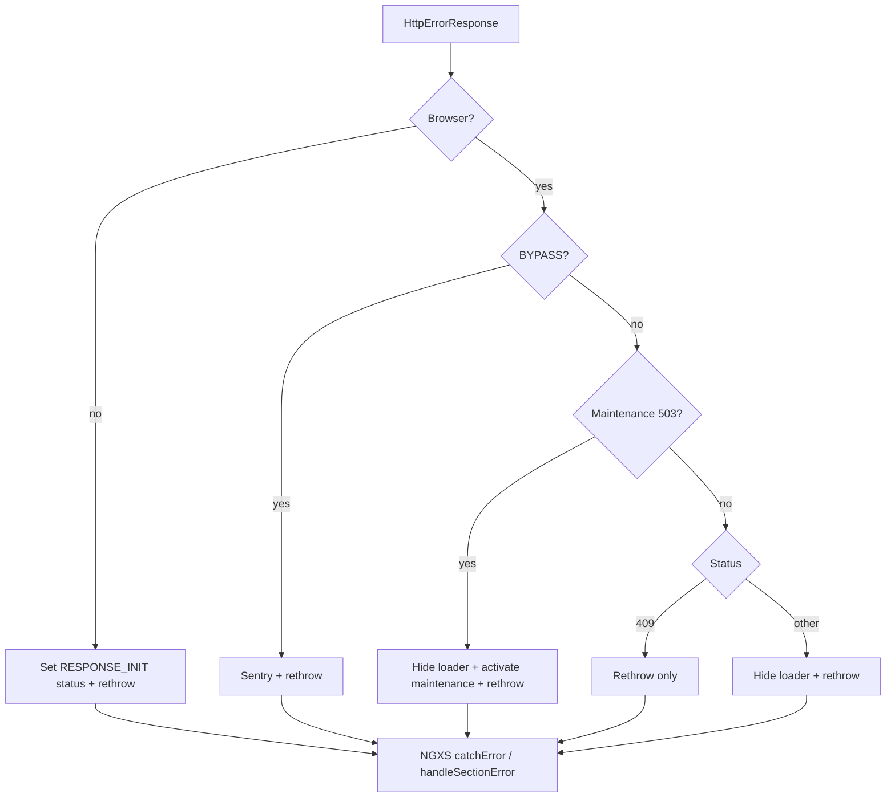

# Error handling

Two complementary layers handle failures from API-backed work:

| Layer                | Responsibility                                                      | Entry point            |
| -------------------- | ------------------------------------------------------------------- | ---------------------- |
| **HTTP interceptor** | Global UX: toast, navigation, auth, maintenance, loader             | `error.interceptor.ts` |
| **NGXS state**       | Section bookkeeping: clear loading flags, store `error`, Sentry tag | `handleSectionError`   |

Both **rethrow**. For a store action that calls HTTP: interceptor runs first → rethrow → state’s `catchError` → `handleSectionError`.

## Index

- [HTTP interceptor](#http-interceptor)
  - [Flow](#flow)
  - [Status handling](#status-handling)
  - [Bypass](#bypass)
  - [Silent 403](#silent-403)
  - [Messages](#messages)
  - [Caller guidelines](#caller-guidelines)
- [NGXS state errors](#ngxs-state-errors)
- [Related files](#related-files)

## HTTP interceptor

Central HTTP UX lives in `src/app/core/interceptors/error.interceptor.ts`. Prefer the interceptor for shared UX; handle locally only when the UI needs a special message or flow.

### Flow

Order before the status `switch` matters:

1. **SSR (`!isBrowser`)** — no toast, navigation, loader, auth, or Sentry. For non-bypassed `401` / `403` / `404` / `410` / `5xx`, set `RESPONSE_INIT.status` on the requested URL; then rethrow. Network/timeout errors (`status: 0`) map to `503`. First non-OK wins, except a later `401` / `403` / `404` / `410` may replace an earlier `5xx`. Silent requests (`X-No-Auth-Redirect` or request-access URL) do not set status for any code; pending-moderation `403`s do. GUID guards (`isFileGuard`, `isProjectGuard`, `isRegistryGuard`) catch errors and return `false`, so matching falls through to `**` (not-found page HTML with the HTTP status from `RESPONSE_INIT`).
2. **Bypass** — Sentry capture + rethrow; skip all UX.
3. **Maintenance** — `503` with `meta.maintenance_mode: true` → hide loader, activate maintenance mode, rethrow.
4. **Status `switch`** — `401` / `403` / `404` / `409` / `410` / default.

After the `switch` (except early `409` return), the interceptor hides the loader and rethrows. `409` does **not** hide the loader; the caller owns that.



### Status handling

| Status    | Interceptor behavior                                                                                                                                                       |
| --------- | -------------------------------------------------------------------------------------------------------------------------------------------------------------------------- |
| **401**   | Skip auth redirect on view-only (`?view_only=`). Else logout if authenticated, or navigate to sign-in. Hide loader.                                                        |
| **403**   | Navigate unless silent / pending-moderation (see below). Node URL → `/request-access/:id` (skipped on draft registry routes). Other → `/forbidden`. Hide loader. No toast. |
| **404**   | Navigate to `/not-found`. Hide loader. No toast.                                                                                                                           |
| **409**   | Rethrow only (no toast, no loader hide). Caller handles conflict UX.                                                                                                       |
| **410**   | Navigate to `/content-deleted`. Hide loader. No toast.                                                                                                                     |
| **Other** | Toast via `getErrorMessage`, hide loader.                                                                                                                                  |

`/not-found` and `/content-deleted` share `PageNotFoundComponent` with different route data (`PAGE_NOT_FOUND_ROUTE_DATA` / `CONTENT_DELETED_ROUTE_DATA`). Browser navigates to those routes (and `/forbidden`) for UX; SSR does not — it only sets `RESPONSE_INIT.status` on the requested URL via `ssr-response-status.helper.ts`.

### Bypass

Use when the **caller** owns all error UX (or the failure must not navigate/toast).

```ts
import { bypassErrorInterceptorContext } from '@core/interceptors/error-interceptor.tokens';

this.http.get(url, { context: bypassErrorInterceptorContext() });
```

`bypassErrorInterceptorContext()` returns a **new** `HttpContext` each call (do not reuse one mutable instance).

Bypass still reports to Sentry and rethrows. It skips toast, navigation, loader, auth, and maintenance activation.

Current examples: maintenance status polling, parent project fetch, Datacite tracker, addon OAuth token refresh, external identity delete.

### Silent 403

These skip `/forbidden` / request-access navigation (loader still hides; error still rethrows):

| Case                        | How                                                                                                                               |
| --------------------------- | --------------------------------------------------------------------------------------------------------------------------------- |
| Metadata record fetch       | `X-No-Auth-Redirect` on `MetadataRecordsService.getMetadataRecord` (optional schema.org; prefer migrating to `HttpContext` later) |
| Node access-request API     | URL matches `/v2/nodes/:id/requests`                                                                                              |
| Preprint pending moderation | Detail equals `PREPRINT_PENDING_MODERATION_DETAIL` — component routes to pending-moderation                                       |

### Messages

`getErrorMessage` resolution:

1. Client `ErrorEvent.message`
2. JSON:API `error.errors[0].detail`
3. For 5xx: `error.message` or `common.errorMessages.serverError`
4. Else `ERROR_MESSAGES[status]` or `common.errorMessages.unknown`

`ERROR_MESSAGES` maps statuses to i18n keys under `common.errorMessages.*`. Toasts run through the translate pipe.

### Caller guidelines

- **Default** — do not toast in the subscriber; the interceptor already does for unhandled statuses.
- **Custom toast / flow** — either `bypassErrorInterceptorContext()` **or** remove the local toast so users do not see two messages.
- **409** — handle in the caller (interceptor is silent).
- **Expected 404/410 on secondary requests** — use bypass; otherwise the interceptor navigates away from the current page.
- **Pending-moderation preprint** — leave interceptor special-case + component navigation; do not send that request with full bypass unless you also handle 404/410/5xx locally.
- **Loader** — interceptor hides for most statuses; for `409` (and bypass) hide in the caller (`finalize` is a good pattern).

## NGXS state errors

Store actions that hit HTTP should end failed sections with `handleSectionError` from `src/app/shared/helpers/state-error.handler.ts`.

It does **not** replace the interceptor. It:

1. Reports to Sentry with `state.section` / feature tags (a second report if the interceptor already captured on bypass)
2. Patches the named section: `isLoading: false`, `isSubmitting: false`, `error: error.message`
3. Rethrows so components / `dispatch` subscribers can still react

```ts
.catchError((error) => handleSectionError(ctx, 'registry', error))
```

`section` must be a key on the state model whose value follows `AsyncStateModel` (see [NGXS docs](./ngxs.md#state-models)):

```ts
export interface AsyncStateModel<T> {
  data: T;
  isLoading: boolean;
  isSubmitting?: boolean;
  error: string | null;
}
```

Guidelines:

- Use `handleSectionError` in action `catchError` for async sections — do not only clear loading in an ad-hoc patch unless the section is not `AsyncStateModel`-shaped.
- Do not toast inside the state handler; leave shared toasts to the interceptor (or the component when bypassed / `409`).
- UI that needs an inline error can read `section.error` from the store; many screens rely on interceptor toasts instead.
- Components that `dispatch(...).subscribe({ error })` still receive the error after both layers.

## Related files

| File                                                    | Role                                       |
| ------------------------------------------------------- | ------------------------------------------ |
| `src/app/core/interceptors/error.interceptor.ts`        | HTTP UX handler                            |
| `src/app/core/interceptors/error-interceptor.tokens.ts` | Bypass token + factory                     |
| `src/app/core/helpers/ssr-response-status.helper.ts`    | SSR `RESPONSE_INIT.status` helper          |
| `src/app/shared/helpers/state-error.handler.ts`         | NGXS section error helper                  |
| `src/app/shared/models/store/async-state.model.ts`      | Async section shape (`error` field)        |
| `src/app/core/constants/error-messages.ts`              | Status → i18n keys                         |
| `src/app/core/constants/http-error-details.const.ts`    | Shared API detail strings                  |
| `src/app/core/constants/page-not-found.constants.ts`    | Route data for 404 / 410 pages             |
| `src/app/core/services/maintenance-mode.service.ts`     | Maintenance detection + activation         |
| `src/app/core/components/page-not-found/`               | Shared not-found / content-deleted UI      |
| `docs/ngxs.md`                                          | Store / `AsyncStateModel` conventions      |
| `docs/sentry.md`                                        | Which HTTP errors are filtered from Sentry |
